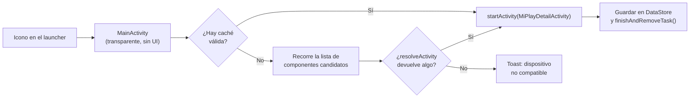

# MiPlay Output Control

Lanzador **invisible** para Android (MIUI / HyperOS) que abre directamente la pantalla de
salida **MiPlay** (`MiPlayDetailActivity`) en cuanto se toca su icono, sin mostrar ninguna UI
intermedia propia.

Pensado para usarse como atajo en un launcher: se le asigna un gesto o un icono, y al pulsarlo
el usuario va directo al panel de MiPlay en vez de navegar por *Ajustes → Conexión y
compartir → MiPlay*.

---

## Cómo funciona

La app es un único `Activity` transparente que actúa como "hop" entre el launcher y la pantalla
del sistema:



### Componentes principales

| Archivo | Responsabilidad |
|---------|-----------------|
| [MainActivity.kt](app/src/main/java/com/personal/miplayoutputcontrol/MainActivity.kt) | Activity transparente. Orquesta la resolución, lanza el destino y se cierra. |
| [MiPlayOutputControlResolver.kt](app/src/main/java/com/personal/miplayoutputcontrol/MiPlayOutputControlResolver.kt) | Decide qué `ComponentName` abrir y lo lanza, gestionando `ActivityNotFoundException` y `SecurityException`. |
| [MiPlayOutputControlTarget.kt](app/src/main/java/com/personal/miplayoutputcontrol/MiPlayOutputControlTarget.kt) | Lista ordenada de componentes candidatos conocidos (del más nuevo al más antiguo). |
| [MiPlayOutputControlStore.kt](app/src/main/java/com/personal/miplayoutputcontrol/MiPlayOutputControlStore.kt) | Caché en DataStore del componente que funcionó la última vez. |

### Decisiones de diseño

- **Sin Compose y sin AppCompat.** Es una app headless: usa `android.app.Activity` puro y un
  tema del sistema (`Theme.Material.NoActionBar`), lo que ahorra el class-loading de AppCompat
  en un arranque que debe medirse en milisegundos.
- **Sin splash.** El tema aplica `windowDisablePreview` y `windowAnimationStyle = @null`, así
  que no se ve parpadeo ni icono al abrir ni al cerrar.
- **Caché del componente ganador.** Resolver un `Intent` contra un paquete ajeno cuesta
  ~1–3 ms. Se guarda el que funcionó y en arranques posteriores se va directo.
- **Auto-reparación.** Si el componente cacheado deja de existir (típico tras una actualización
  de HyperOS), se limpia la caché y se reintenta con la lista completa una sola vez.
- **Red de seguridad.** Si la pantalla destino tarda en dibujar, la Activity se cierra igualmente
  a los 1500 ms para no dejar una ventana transparente que capture toques.
- **Kotlin integrado en AGP 9.** No se aplica `org.jetbrains.kotlin.android`; lo aporta AGP
  mediante `android.builtInKotlin=true` (ver [gradle.properties](gradle.properties)).

---

## Requisitos

- Android **8.0 (API 26)** o superior.
- Dispositivo **Xiaomi / Redmi / POCO** con **MIUI 13+** o **HyperOS**, donde exista
  `miui.systemui.plugin/miui.systemui.miplay.MiPlayDetailActivity`.
- JDK **17** y Android SDK **34** para compilar.

## Compilar e instalar

```bash
# Clonar
git clone https://github.com/KryptAle/miplay-launcher-invisible.git
cd miplay-launcher-invisible

# Compilar el APK de debug
./gradlew assembleDebug

# Instalar en el dispositivo conectado
adb install -r app/build/outputs/apk/debug/app-debug.apk
```

En Windows (cmd/PowerShell) usa `gradlew.bat` en lugar de `./gradlew`.

> [!NOTE]
> No hace falta configurar `local.properties`: Android Studio lo genera al abrir el proyecto.
> Ese archivo está excluido del repositorio porque contiene la ruta local del SDK.

### Build de release

El `buildType` de release activa R8 completo (`minifyEnabled` + `shrinkResources`) y, por
comodidad en pruebas locales, firma con la clave de debug:

```bash
./gradlew assembleRelease
```

> [!WARNING]
> Para publicar en una tienda o distribuir el APK, sustituye `signingConfig` en
> [app/build.gradle](app/build.gradle) por tu propia clave de release y **no** subas el keystore
> al repositorio (ya está cubierto por `.gitignore`).

---

## Verificar que funciona en tu dispositivo

El nombre del componente MiPlay puede variar entre builds de HyperOS. Para comprobar cuál
existe en tu terminal:

```bash
adb shell dumpsys package miui.systemui.plugin | grep -i miplay
```

Si aparece un componente distinto al de
[MiPlayOutputControlTarget.kt](app/src/main/java/com/personal/miplayoutputcontrol/MiPlayOutputControlTarget.kt),
añádelo a la lista `CANDIDATES` en el orden adecuado.

También puedes lanzarlo a mano para confirmar que el sistema lo permite:

```bash
adb shell am start -n miui.systemui.plugin/miui.systemui.miplay.MiPlayDetailActivity
```

Un `SecurityException` o `Permission Denial` significa que el fabricante ha bloqueado el
componente para apps de terceros; en ese caso la app mostrará el toast
*"El sistema bloqueó el lanzamiento"*.

---

## Limitaciones conocidas

- El componente de destino es **propietario de Xiaomi** y no forma parte de la API pública de
  Android. Puede cambiar o desaparecer en cualquier actualización de MIUI/HyperOS.
- Algunas builds restringen la apertura de componentes internos de SystemUI desde apps de
  terceros. La app lo detecta y lo comunica, pero no puede evitarlo.
- No hay UI de configuración: la app es intencionadamente invisible y sin pantalla propia.

## Aviso

Proyecto personal, no oficial ni afiliado a Xiaomi. Úsalo bajo tu responsabilidad: modifica
únicamente ajustes del sistema y no accede a datos de usuario.
